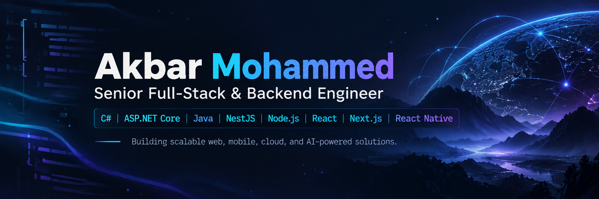

  

   

  
  

  
<strong>Backend engineering · Full-stack products · Cloud infrastructure · AI integration</strong>

## 👋 About me

I'm **Akbar Mohammed**, a **Senior Full-Stack & Backend Engineer** who enjoys designing dependable systems and turning complex requirements into practical, maintainable software.

My work spans **C# / ASP.NET Core, Java, NestJS, and Node.js** on the backend, with **React, Next.js, and React Native** for web and mobile experiences. I focus on the parts that make applications work well beyond the demo: clear APIs, solid data models, performance, security, and reliable deployments.

## 🛠️ Technical Skills

My background combines **backend development, enterprise integrations, data processing, and production support**, supported by hands-on web development and cloud tooling.

### ⚙️ Backend Development & APIs

**Areas of work:** API development and integration, data mapping, application troubleshooting, and enterprise system connectivity.

### 🌐 Frontend & Web Technologies

### 🗄️ Databases & Data Analytics

**Areas of work:** Data processing, validation, cleanup, migration, reporting, and dashboard development.

### ☁️ Cloud, DevOps & Developer Tools

### 🏢 Enterprise Systems & Integrations

**Areas of work:** HR/payroll integrations, timekeeping workflows, enterprise application support, requirements analysis, and data exchange between systems.

### ✅ Testing, Quality & Support

`Unit Testing` · `Integration Testing` · `User Acceptance Testing (UAT)` · `Debugging` · `Root Cause Analysis` · `Production Support` · `Technical Documentation`

## 🧩 What I focus on

| Engineering | What it means in practice |
| :-- | :-- |
| **Backend architecture** | Maintainable services, REST APIs, authentication, authorization, and integrations |
| **Data & performance** | Thoughtful database design, caching, background jobs, and efficient queries |
| **Distributed systems** | Queues, event-driven workflows, service communication, and fault tolerance |
| **Full-stack delivery** | Connecting robust backends with responsive web and mobile interfaces |
| **Cloud & automation** | Deployment pipelines, infrastructure, monitoring, and operational reliability |
| **AI-powered products** | LLM API integrations, automation, and intelligent application features |

## 🛠️ How I approach software

> Build for clarity. Design for change. Make reliability a feature.

I value pragmatic architecture, readable code, good documentation, and solutions that are easy to maintain. The goal is not just to make features work, but to make them **secure, measurable, and dependable** as products grow.

<!-- When you have verified public projects, replace this section with 2–3 real case studies.
     Suggested format: Project name | Problem solved | Tech stack | Source/demo link.
     Avoid presenting generated activity-log commits as historical development work. -->

---

  Thanks for visiting — I'm always interested in thoughtful engineering and building useful software.

